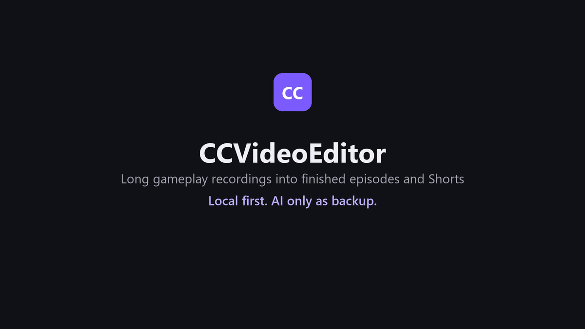
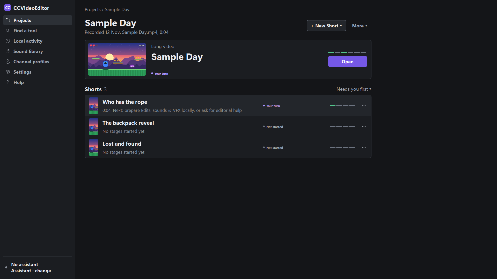
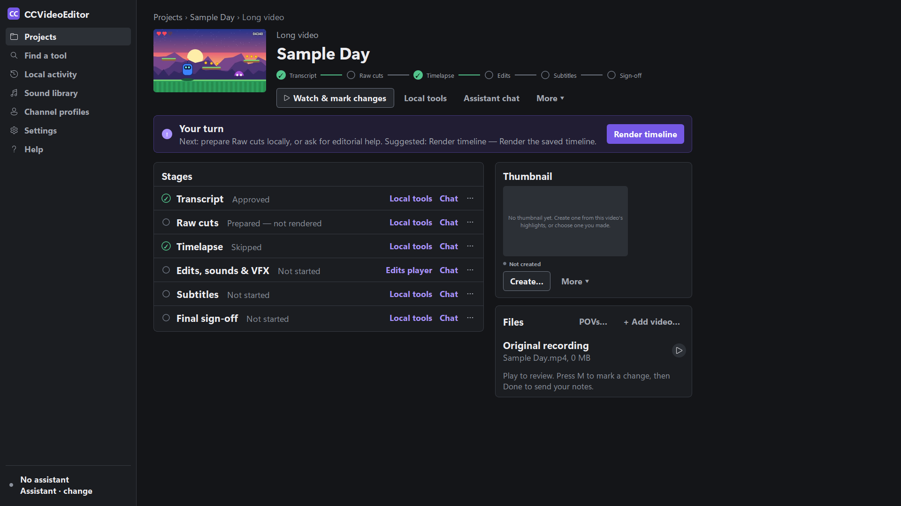

# CCVideoEditor

**A Windows desktop app that turns hours of gameplay or stream footage into finished YouTube episodes and Shorts. Every stage is reviewed by a person before anything moves on.**

> 🚧 **Work in progress.** It is actively developed (September 2026 to now), and this page is updated as it goes. The source code is private.

### ▶ 35-second walkthrough

Captured from the real app running a sample project with made-up speakers and an original placeholder game clip. No real recordings or personal data. [Download as MP4](media/demo.mp4).

---

## The idea

Editing a multi-hour recording session into an episode takes days. CCVideoEditor breaks the work into stages. **Local tools do the heavy lifting at each stage**, with an optional AI assistant on standby, and **you approve every stage** with a review round before anything moves on.

| Long video | Short |
|---|---|
| Transcript → Raw cuts → Timelapse → Edits, sounds & VFX → Subtitles → Final sign-off | Raw cuts → Edits, sounds & VFX → Subtitles → Final sign-off |

## Local first: AI is the backup, not the engine

Many AI video tools send every step to a model and bill you in tokens for work a script could do. CCVideoEditor works the other way round.

- **Routine work never touches AI.** Every stage has a **Run locally** button. Transcription (offline Whisper), cutting, captions, sound mixing, graphics, rendering and technical QA all run on your own PC with Python and FFmpeg, using **zero tokens**.
- **The app always suggests the next step.** A "Your turn" banner shows the next local action for each stage. A full long video has gone from transcript to final sign-off by following those suggestions alone, **without an assistant ever being started**.
- **You decide when to spend tokens.** The assistant is something you ask for when you want it, for creative calls or when you're stuck. Each chat shows its own token usage, so the cost is never hidden.
- **When something breaks, AI gets you back on track.** Local jobs keep their logs, progress and errors, with **Retry, Cancel and Undo**. Nothing retries silently in a loop. If a step fails or you get stuck, press **Chat** on that stage. The assistant can read the project's logs and state, diagnose the problem, and finish the stage with the same tools and review rounds. You then carry on locally.

The result is that the expensive part, the model, is used for judgement and recovery. The repetitive part runs locally, for free.

## What I built

About **170 Python modules (~59,000 lines)** with **150+ test files**, across 130+ commits.

- **Desktop app (Qt / PySide6).** Project and stage pages, a review player with "Watch & mark" notes, timeline, caption and sound editors, a sound library, channel profiles, and an assistant chat.
- **Local pipeline.**
  - GPU transcription with word-level alignment and speaker labels.
  - Keep-range cutting, timelapses, styled captions, sound-effect and graphics placement.
  - FFmpeg rendering and technical QA (decode, sync, caption bounds).
  - Every tool runs as a queued local job.
- **Review rounds.** Each stage produces one card per change, with its own clip, approve/reject, notes and exact adjustments ("move this cut", "nudge this sound", "fix this caption word").
- **Multi-POV editing.** Cut between several players' recordings of the same session, with speaker avatars.
- **Optional AI assistant.** Claude Code or Codex can step in for creative calls or to recover a failed stage. It uses the same tools and review rounds, so a person always approves.
- **Multi-PC workflow.** A hub syncs projects between PCs: one editor per video, with local copies kept in step.
- **Privacy.** Everything runs locally: no server, no uploads.

## Tech stack

`Python` · `PySide6 / Qt` · `FFmpeg` · `faster-whisper` · `NeMo` (speaker detection) · `PANNs` (audio events) · `numpy` · `Pillow` · `pytest` · `ruff` / `mypy` · `Claude Code / Codex integration`

## Roadmap

<!-- Keep this list current as the project moves -->
- [x] Walkthrough of the app
- [ ] Before-and-after demo with real gameplay footage
- [ ] Thumbnail generation improvements
- [ ] Broader content styles beyond co-op gameplay commentary

---

© 2026 Hunter Miller. All rights reserved. See [LICENSE](LICENSE).
